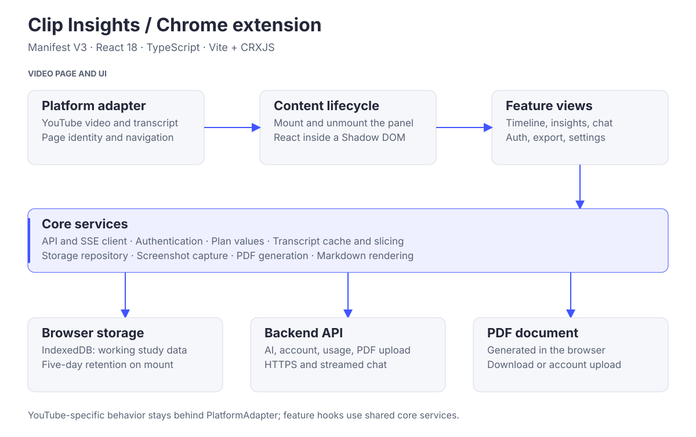

# Browser extension architecture

Clip Insights is a Manifest V3 extension built with React 18, TypeScript, Vite, and CRXJS. It adds a study panel to YouTube watch pages. Notes, screenshots, transcript access, AI views, and PDF export share a platform adapter and core services.

## Runtime structure



## Code map

| Location | Responsibility |
| --- | --- |
| `src/background/sw.ts` | Extension service worker. |
| `src/content` | Entry point, panel mounting, and page lifecycle. |
| `src/platforms/youtube` | YouTube DOM selection, video identity, transcript access, and navigation. |
| `src/core/platform` | `PlatformAdapter` interface and adapter registry. |
| `src/features` | Feature views and hooks for timeline, insights, chat, auth, export, transcript, and settings. |
| `src/core/api` | Typed request/response boundaries, authenticated requests, SSE parsing. |
| `src/core/storage` | IndexedDB bootstrap, repository operations, retention cleanup. |
| `src/core/transcript` | Shared transcript cache and token-budget slicing. |
| `src/core/auth` | Session lifecycle, token storage, and Google sign-in. |
| `src/core/pdf` | PDF generation and mixed-script text layout. |
| `src/ui` | Panel composition, shared controls, icons, notifications, and scoped styles. |

## Platform integration

The `PlatformAdapter` isolates host-specific behavior: locating the video and panel container, identifying the content, reading its title and transcript, and responding to navigation. The YouTube adapter mounts the panel near the top of the watch-page sidebar, using `#secondary-inner` with a fallback container.

To add a platform:

1. Add its host patterns to `PLATFORM_MATCHES` in `manifest.config.ts`.
2. Implement `PlatformAdapter` under `src/platforms/<name>`.
3. Register the adapter with the platform registry.

YouTube is the implemented platform. Other learning sites require their own adapters and verification.

## Notes, screenshots, and storage

Timeline items are associated with the video URL. Timestamp controls seek to the corresponding moment through the adapter's video element. Screenshots are downscaled before storage, and failed saves show a notification without discarding a note draft.

IndexedDB uses database `YouTubeNotesDatabase`, version `1`. Its stores are `textNotes`, `screenshots`, `summaries`, and `keypoints`, with auto-incrementing `id` keys and a `byVideoUrl` index. These names and shapes are a persistence contract and must remain stable.

Retention cleanup runs when the panel mounts and deletes records older than five days. Working notes should be exported or saved as a PDF for longer-term retention. Plan settings also constrain note length and the number of notes and screenshots per video.

## Transcript and AI requests

The transcript cache is shared by transcript copy, insights, and chat. Successful transcript reads are cached per content ID; failed reads are not cached. Text is sliced to the backend token budget before AI requests. Unavailable transcripts produce a visible message rather than an AI request containing an error sentinel.

Summary and key-point generation is explicit: opening a view does not generate content automatically. Cached results can be regenerated or cleared. The backend returns summary text and structured key points.

Chat sends the video URL, sliced transcript, question, and recent conversation. The backend performs RAG retrieval and streams JSON-encoded tokens as server-sent events ending in `[DONE]`. The extension parses the stream incrementally and displays waiting and streaming states. See the [system architecture](https://github.com/Clip-Insights/.github/blob/main/docs/ARCHITECTURE.md#video-question-answering) for retrieval details.

Markdown output is parsed with `marked` and sanitized with DOMPurify before rendering. Tables and code blocks scroll within the panel.

## Authentication and limits

The panel supports email/password and Google sign-in. Core authentication services manage the session and token refresh. A build-time token key obfuscates credentials stored locally; browser-side obfuscation does not provide secret storage.

The backend supplies plan allowances and usage counters and enforces AI request limits. Settings show account details, plan usage, reset timing, and logout. Sign-up and account links open [app.clipinsights.org](https://app.clipinsights.org).

## PDF export

PDF generation runs inside the extension using jsPDF. It assembles study content with timestamped notes and screenshots into a branded document that can be downloaded or uploaded to the authenticated account.

The rich-text renderer preserves line breaks and wraps mixed text runs. Characters supported by the PDF font remain text; other scripts and emoji are rendered through the browser to inline images. This supports visible mixed-script output, while rasterized characters do not have the same text-selection behavior as native PDF text.

## Styling and browser behavior

The panel mounts inside a Shadow DOM. Shared CSS custom properties in `src/ui/styles.css` define colors, spacing, and panel dimensions. Views use a fixed-height flex layout with a scrollable content area (`flex: 1; min-height: 0`). New views should use the same layout and shared controls.

Keyboard isolation respects the Shadow DOM boundary. Chat uses Enter to send and Shift+Enter for a line break. Panel interactions must preserve the host video's normal controls outside the extension.

## Configuration

| Variable | Purpose |
| --- | --- |
| `VITE_API_URL` | Backend base URL. |
| `VITE_WEB_APP_URL` | Account links; defaults to `https://app.clipinsights.org`. |
| `VITE_GOOGLE_EXTENSION_CLIENT_ID` | Google sign-in client ID. |
| `VITE_TOKEN_SECRET` | Client-side token obfuscation key. |

These values are embedded at build time. Do not put backend credentials in extension configuration.

## Build and verification

```bash
npm run test
npm run build
```

Vitest covers pure core logic, including transcript slicing and caching, stream parsing, formatting, markdown, and PDF text layout. Browser-only behavior still requires manual verification: load `dist/` at `chrome://extensions`, open a watch page, and exercise capture, notes, insights, chat, and PDF export.

For visual changes, serve `render-harness.html` over local HTTP and inspect all views at approximately 360px and 320px widths. Check for clipped controls, horizontal overflow, and inconsistent panel heights. The harness uses the real stylesheet but does not replace a live-extension check.

Reload the unpacked extension after every production rebuild. Contributor rules are in [AGENTS.md](./AGENTS.md).
