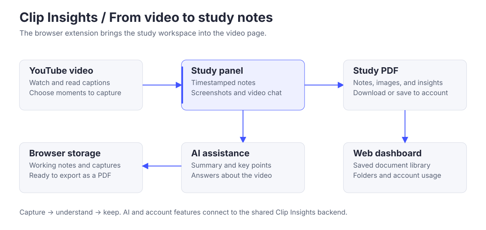

# Clip Insights · Chrome extension

### Turn a video into study notes.

Capture useful moments from YouTube, ask questions about the content, and keep your learning in a PDF.

[Install extension](https://chromewebstore.google.com/detail/ccgechmifoecebnimnccgahnoklklilj) · [Website](https://clipinsights.org) · [Web app](https://app.clipinsights.org)

## The study workspace

| Capture | Understand | Keep |
| --- | --- | --- |
| Timestamped screenshots and notes. | AI summaries, key points, and conversation about the video. | Copy the transcript, download a PDF, or save it to your account. |

## How it works



The study panel sits beside the video. Notes and screenshots stay in the browser while you work; the shared backend supplies AI insights and account services. Exported PDFs can be downloaded or organized in the web dashboard.

AI features require sign-in, available captions, and allowance under the account plan. Local working records have a five-day retention period, so export a PDF to keep a session.

## Built with

**React 18 · TypeScript · Vite · CRXJS · Manifest V3 · IndexedDB · jsPDF**

Extension version: **4.0.5**.

The panel uses a Shadow DOM to isolate its appearance from YouTube. A platform adapter handles video context and navigation, while shared services support the study tools.

## Run locally

Use Node.js 22.12 or later. Follow the [development guide](./docs/DEVELOPMENT.md) to configure the backend connection and sign-in.

```bash
npm ci
npm run build
```

Load `dist/` as an unpacked extension at `chrome://extensions`. Run `npm test` for the core test suite.

## Explore further

[Detailed architecture](./ARCHITECTURE.md) · [Release notes](./docs/releases/README.md) · [Permissions and data flow](./docs/policies.md) · [Contributing](./AGENTS.md)

Part of [Clip Insights](https://github.com/Clip-Insights): [backend](https://github.com/Clip-Insights/backend) · [web app](https://github.com/Clip-Insights/web-app) · [public website](https://github.com/Clip-Insights/main-site).
